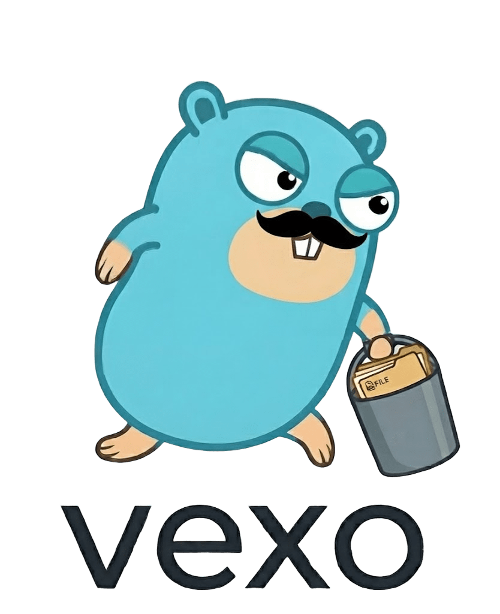

# vexo

  

vexo is a small object store you run on one machine. It speaks the S3 HTTP API, so you talk to it with signed S3 requests. It also ships a web console to manage buckets, files, users and policies.

Everything is stored in one folder. Metadata lives in a single [bbolt](https://github.com/etcd-io/bbolt) file. No external database.

!!! warning "Work in progress"
    vexo is young. Some S3 features are missing. See [What works today](#what-works-today).

## What you get

- **S3 API** on port `9090`. Create buckets, upload, download, list and delete objects.
- **SigV4 auth**. Requests are signed the same way as real AWS S3.
- **IAM**. Users, groups and access keys.
- **Policies**. AWS-style JSON policies. An explicit `Deny` always wins.
- **Tiering**. Objects move from `hot` to `infrequent` to `cold` (gzip) based on rules.
- **Web console** on port `9091`. Browse files, share links, manage users.

## Where to start

| I want to... | Read |
| --- | --- |
| Run vexo | [Getting started](getting-started.md) |
| Change ports or the data folder | [Configuration](configuration.md) |
| Upload and download files | [Using the S3 API](s3-api.md) |
| Use the dashboard and share files | [Web console](console.md) |
| Give someone limited access | [Users, keys and policies](iam.md) |
| Move old files to cheaper storage | [Lifecycle and tiering](lifecycle.md) |

## What works today

| Feature | Status |
| --- | --- |
| Bucket create / delete / head / list | Done |
| Object put / get / head / delete / list with `prefix` | Done |
| SigV4 auth with signed payload | Done |
| Users, groups, access keys, policies | Done |
| Web console, share links, public buckets | Done |
| Lifecycle tiering engine | Done (no API to set rules yet) |
| `UNSIGNED-PAYLOAD` / streaming uploads | Not yet |
| Multipart upload | Not yet |
| `?lifecycle` S3 sub-resource | Not yet |
